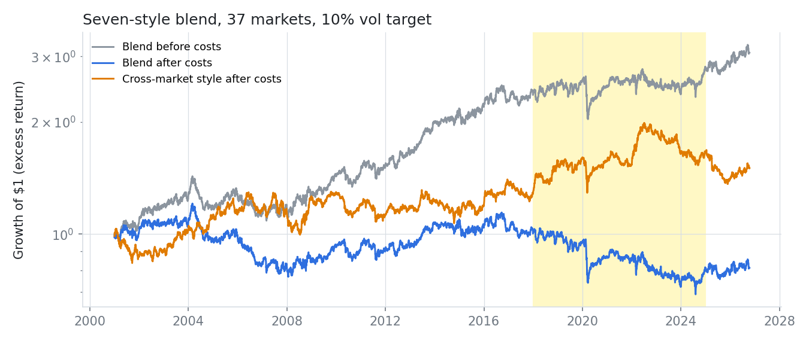
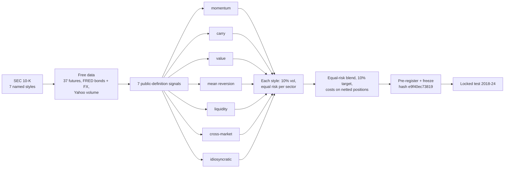
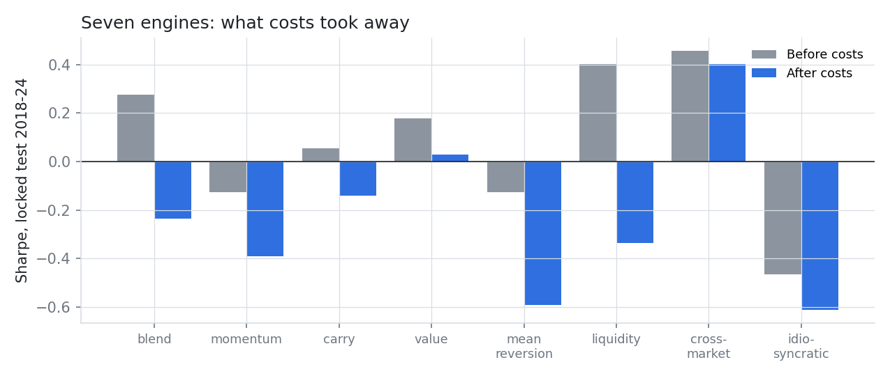
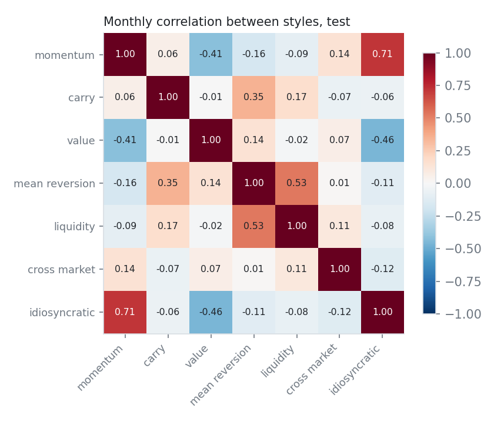

# Seven Engines

### A futures manager says its seven model styles deliver returns "uncorrelated to traditional asset classes and the managed futures asset class". Built from public definitions, does that architecture deliver?


> **TL;DR.** A 10-K names seven model styles (carry, cross-market, idiosyncratic, liquidity, mean reversion,
> momentum, value) but gives no formulas. We built each from its standard academic definition on 37 free-data
> futures markets, blended them with equal risk, and tested the filing's claims in a locked 2018-24 period.
> **The diversification claim held:** correlation with trend-following managed futures 0.16 (95% CI upper bound
> 0.39), and an average pairwise correlation of 0.03 between styles. **Costs were the binding constraint:** a 0.28
> Sharpe before costs became -0.24 after a 5.4%-of-NAV yearly trading bill. **Cross-market lead-lag signals were the
> one engine that worked out of sample** (net Sharpe 0.40).



---

## 1. The research: what the filing says

Source: the 10-K of a multi-advisor commodity pool (fiscal 2020), describing one advisor's "systematic global macro"
programme (25% of the pool's capital). Verbatim:

> *"The trading strategies are generally medium-term and aim to exploit a number of sources of alpha based upon
> fundamental, technical, and liquidity effects. This managed futures strategy consists of seven different model
> styles, which include carry, cross-market, idiosyncratic, liquidity, mean reversion, momentum, and value models.
> By applying each of these trading styles, across multiple time horizons, the strategy blends multiple alpha
> drivers seeking consistent returns, uncorrelated to traditional asset classes and the managed futures asset class."*

Full citation and what we take from each sentence: [`research/institutional_methodology.md`](research/institutional_methodology.md).

## 2. The gap

| What is missing | Why it matters |
|---|---|
| **Formulas.** The filing names seven styles and nothing else. | Investors buy an architecture they cannot inspect. |
| **A test of the "uncorrelated" claim.** It is the main selling point of multi-style programmes, and is rarely tested out of sample against a real managed-futures benchmark. | If the styles are just trend in disguise, the diversification is an illusion. |
| **Net-of-cost evidence.** Most style-premia papers report gross returns at monthly rebalancing. | Fast styles (mean reversion, liquidity) are where costs bite hardest. |
| **Cross-market signals inside a multi-style book.** Lead-lag effects between bonds, equities and currencies (Pitkajarvi, Suominen & Vaittinen 2020) are rarely tested next to the standard styles. | They may be the genuinely new engine, or already spanned. |

## 3. Our solution



| Style | Definition (fixed before the test) | Source |
|---|---|---|
| Momentum | rank within sector of the 12-1 month return t-stat | Asness, Moskowitz & Pedersen (2013) |
| Carry | FX: rate differential; bonds: (yield - bill) / vol | Koijen, Moskowitz, Pedersen & Vrugt (2018) |
| Value | log(average price 4.5-5.5 years ago / price), ranked within sector | Asness, Moskowitz & Pedersen (2013) |
| Mean reversion | tanh of minus the 5-day return t-stat | the manager's "<10-day" short-term models |
| Liquidity | minus the 1-day return x abnormal volume: high-volume moves reverse | Campbell, Grossman & Wang (1993) |
| Cross-market | bonds -> equities (+), equities -> bonds (-), local equity -> currency, metals -> AUD, oil -> CAD/MXN | Pitkajarvi, Suominen & Vaittinen (2020) |
| Idiosyncratic | 12-1 month momentum of the return relative to the sector average | residual momentum (Blitz, Huij & Martens 2011) |

## 4. Results (locked test 2018-24, 84 months)

| | Claim from the 10-K | Result | Verdict |
|---|---|---|---|
| **H1** | The blend earns a positive return | net Sharpe -0.24 [-0.72, 0.29]; gross 0.28 | Not supported (predicted) |
| **H2** | "uncorrelated to ... the managed futures asset class" | corr 0.16, 95% CI [-0.07, 0.39] | **Supported** |
| **H3** | "uncorrelated to traditional asset classes" (60/40) | corr 0.19, CI [-0.18, 0.54] | Not supported (CI too wide) |
| **H4** | The blend beats its best backtested style | +0.38, p = 0.15 | Not supported |

|  |  |
|---|---|

| Style (test) | Net Sharpe | Gross Sharpe | Cost/yr |
|---|---|---|---|
| **Blend** | -0.24 | 0.28 | 5.4% |
| Blend at half cost | 0.02 | 0.28 | 2.7% |
| **Cross-market** | **0.40** | 0.46 | 0.6% |
| Value | 0.03 | 0.18 | 1.2% |
| Carry | -0.14 | 0.05 | 1.2% |
| Liquidity | -0.34 | 0.40 | 9.2% |
| Momentum | -0.39 | -0.13 | 2.2% |
| Mean reversion | -0.59 | -0.13 | 5.2% |
| Idiosyncratic | -0.61 | -0.46 | 1.2% |

## 5. What we learned

1. **The diversification is real.** The seven styles are different return streams (average pairwise correlation
   0.03; the close cousins are momentum/idiosyncratic at 0.71 and mean reversion/liquidity at 0.53), and the blend
   barely co-moves with trend followers.
2. **Execution, not signals, decides the outcome.** Liquidity earned a 0.40 Sharpe before costs and -0.34 after.
   The blend was profitable before costs in development (0.54), validation (0.87) and the test (0.28).
3. **Cross-market links are the engine worth studying next.** Bond, equity and commodity lead-lags were positive out
   of sample with almost no turnover.
4. **The best backtest flopped.** Idiosyncratic momentum ranked first on 2001-17 data and last in the test, a clean
   example of why picking the best backtest is not a strategy.

## 6. How we kept it honest

Pre-registration frozen (hash `e9f40ec73819`) before 2018+ data could load. One alternative (21-day mean reversion,
5-day liquidity, motivated by the filing's "generally medium-term") was tried on development data, did worse, and
was rejected; both are in [`research/experiment_log.md`](research/experiment_log.md). A look-ahead test checks that
signals and weights never change when later data change.

## 7. Reproduce

```bash
pip install -e ./qcore -e .
python scripts/run.py download && python scripts/run.py build
python scripts/run.py dev
PREREG_HASH=e9f40ec73819 python scripts/run.py test
PREREG_HASH=e9f40ec73819 python scripts/figures.py
pytest
```

## 8. Repository map

```
configs/            universe (37 markets, costs, volume proxies), period splits
src/multistyle/     data.py, macro.py (carry-correct bonds + FX), model.py (7 styles, blend), analysis.py
scripts/            run.py (dev / test, hypothesis tests), figures.py
research/           institutional_methodology, preregistration, experiment_log, results, limitations, sources/
results/            figures/, tables/ (summaries, style correlations)
qcore/              period splits with the test lock, metrics, stationary bootstrap
tests/              look-ahead tests
```

**Limitations** ([full list](research/limitations.md)): no commodity or equity carry (front-month data); Yahoo volume
is noisy around rolls; costs are small-size estimates; public definitions, not the manager's; 84 test months.

*Research artifact, not investment advice.*
